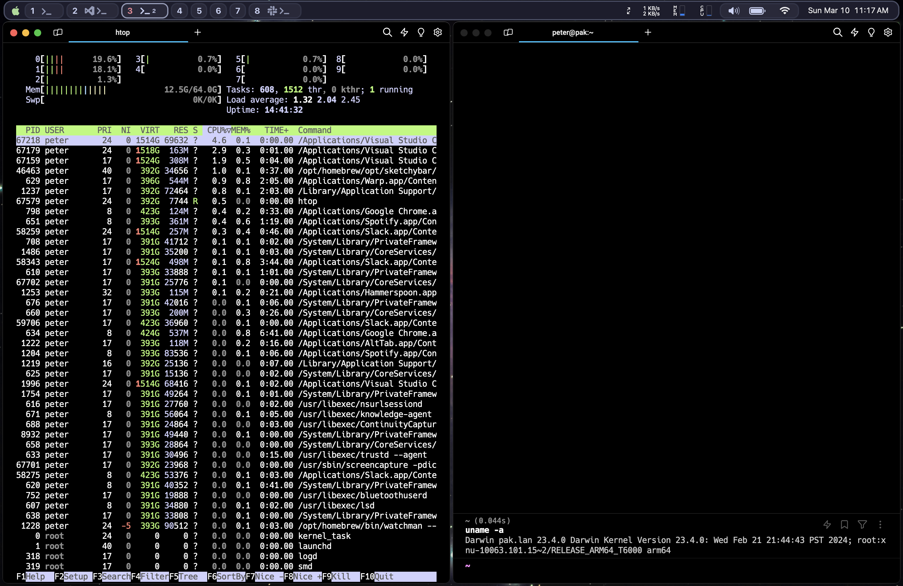

# macrice

macOS desktop rice. AeroSpace + SketchyBar + Hammerspoon + Karabiner + Claude Code.



## Stack

- **[AeroSpace](https://github.com/nikitabobko/AeroSpace)** -- i3-like tiling window manager
- **[SketchyBar](https://github.com/FelixKratz/SketchyBar)** -- custom menu bar with dynamic workspace indicators
- **[Hammerspoon](https://www.hammerspoon.org/)** -- app launching hotkeys and media controls
- **[Karabiner-Elements](https://karabiner-elements.pqrs.org/)** -- Caps Lock remapped to Hyper key (Alt+Ctrl+Shift)
- **[Claude Code](https://docs.anthropic.com/en/docs/claude-code)** -- AI session tracking with visual status in SketchyBar

## Prerequisites

```bash
brew install koekeishiya/formulae/sketchybar
brew install --cask nikitabobko/tap/aerospace
brew install --cask hammerspoon
brew install --cask karabiner-elements
brew install --cask sf-symbols
brew install --cask font-sf-pro
brew install stow
```

Fonts: SketchyBar uses **SF Pro** for labels and **SF Symbols** for icons. Both are installed via the brew commands above.

## Install

```bash
git clone git@github.com:Shubhaankar-Sharma/macrice.git ~/config/macrice
cd ~/config/macrice
./install.sh
```

Or manually with stow:

```bash
cd ~/config/macrice
stow aerospace sketchybar hammerspoon karabiner
```

Each top-level directory is a [GNU Stow](https://www.gnu.org/software/stow/) package that mirrors `$HOME`. Running `stow <package>` symlinks everything into the right place.

The Claude hooks live in `claude-hooks/` as a reference — copy them into `~/.claude/hooks/` since that directory has other user-specific files that can't be stowed.

## Keybindings

Caps Lock is remapped to **Hyper** (Alt+Ctrl+Shift) via Karabiner. Adding Cmd gives **Hyperc** (Cmd+Alt+Ctrl+Shift).

### Window Management (AeroSpace)

| Key | Action |
|-----|--------|
| hyper + h/j/k/l | Focus window left/down/up/right |
| hyper + arrows | Focus window (arrow keys) |
| hyperc + h/j/k/l | Move window left/down/up/right |
| hyper + 1-9, 0 | Switch to workspace 1-10 |
| hyperc + 1-9, 0 | Move window to workspace 1-10 |
| hyper + [ / ] | Previous / next workspace |
| hyper + tab | Toggle last workspace |
| hyper + f | Toggle fullscreen |
| hyper + space | Toggle floating / tiling |
| hyper + r | Rotate layout |
| hyper + \ | Split horizontal |
| hyper + - | Split vertical |
| hyper + ; / ' | Shrink / grow window |
| hyper + = | Enter resize mode (then hjkl) |
| hyper + s | Enter service mode |
| hyperc + b | Balance window sizes |
| hyperc + r | Reload AeroSpace config |

### App Launching (Hammerspoon)

| Key | App |
|-----|-----|
| hyper + a | Arc |
| hyper + t | Ghostty |
| hyper + x | VS Code |
| hyper + j | Slack |
| hyper + k | Discord |
| hyper + w | WhatsApp |
| hyper + s | Spotify |
| hyper + return | New terminal window |
| hyper + l | Lock screen |

### Media (Hammerspoon)

| Key | Action |
|-----|--------|
| hyper + . | Next track |
| hyper + , | Previous track |
| hyper + / | Play / pause |

## Claude Code Integration

The `claude` stow package adds hooks to `~/.claude/` that integrate Claude Code sessions with SketchyBar. Each workspace with an active Claude session gets a colored background indicator:

- **Purple** -- Claude is actively working (tool use, thinking)
- **Amber** -- Claude is waiting for user input

### How it works

1. **register-session.sh** (SessionStart) -- registers the session in `/tmp/claude-agents/<workspace>.json` with project name, branch, and Claude's PID
2. **focus-workspace.sh** (Stop, Notification) -- switches AeroSpace focus to the workspace when Claude needs attention
3. **session-active.sh** (PreToolUse, UserPromptSubmit) -- flips status to active and updates SketchyBar color
4. **session-waiting.sh** (Stop) -- flips status to waiting and updates SketchyBar color
5. **claude_refresh.sh** (SketchyBar plugin, every 5s) -- catches idle sessions via CPU monitoring, cleans up dead processes

### Setup

Copy hooks and merge settings:

```bash
cp claude-hooks/.claude/hooks/*.sh ~/.claude/hooks/
chmod +x ~/.claude/hooks/*.sh
```

Then merge the hooks config from `claude-hooks/.claude/settings.json.example` into your `~/.claude/settings.json`.

Add to your `.zshrc` so hooks know which workspace they're in:

```bash
if [[ $- == *i* ]] && [[ -z "$AEROSPACE_WS" ]]; then
  export AEROSPACE_WS=$(aerospace list-workspaces --focused 2>/dev/null)
fi
```

## Customization

### Workspace names

Edit `aerospace/.config/aerospace/aerospace.toml` to rename workspaces. The default uses numbered workspaces (1-10). You can use named workspaces -- just update both the switching and move-to-workspace bindings.

### App launchers

Edit `hammerspoon/.hammerspoon/init.lua` and modify the `hotApps` table.

### SketchyBar colors

Edit `sketchybar/.config/sketchybar/colors.sh` to change the color scheme.

### Monitor assignment

Edit the `[workspace-to-monitor-force-assignment]` section in `aerospace.toml` to match your monitor setup.
